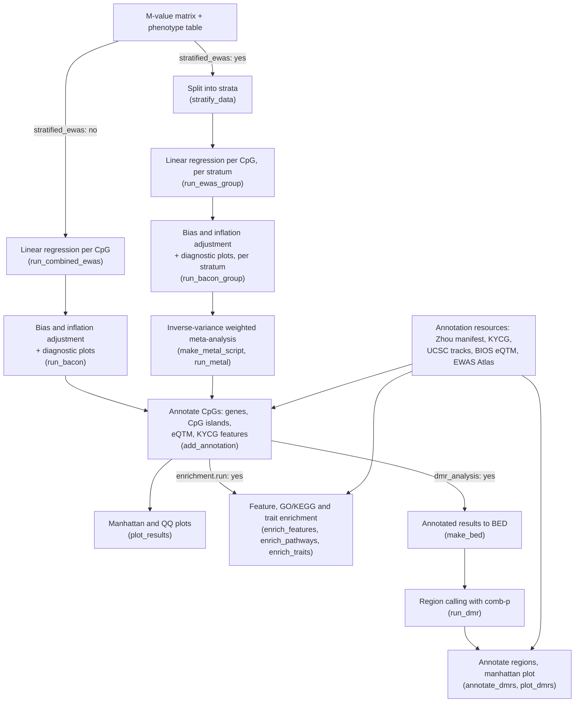
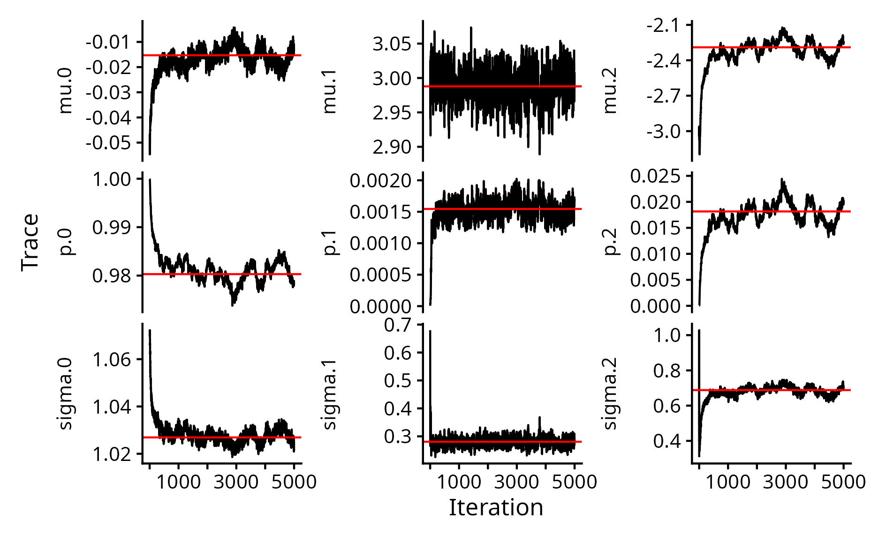
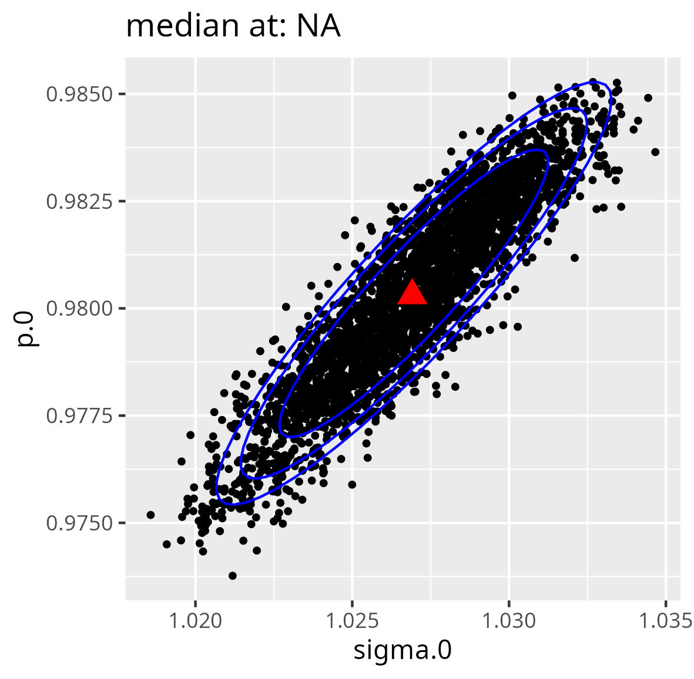
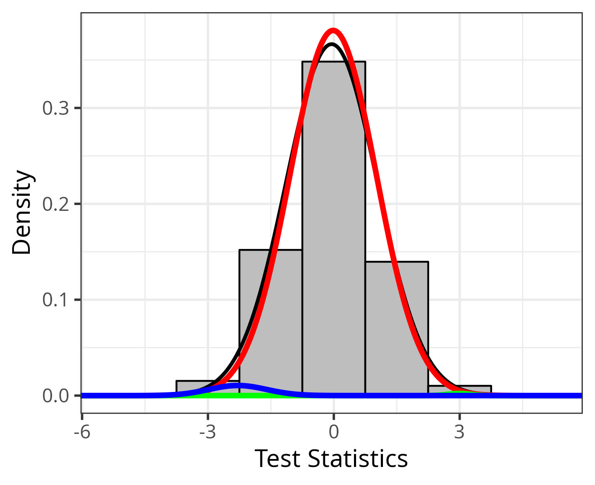
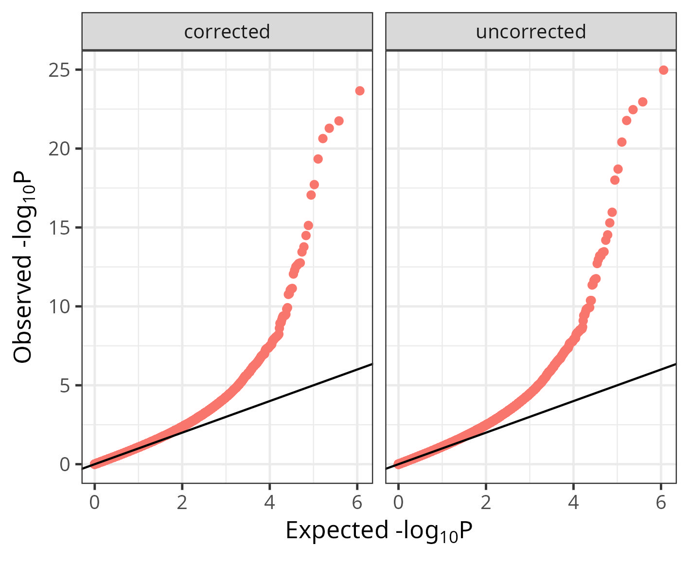

# Overview

---
> **Version 2.0.** The previous stable release is available as tag [`v1.2`](https://github.com/krferrier/EWAS/tree/v1.2).
>
> 📖 **Documentation:** [krferrier.github.io/EWAS](https://krferrier.github.io/EWAS/)

This repository is a snakemake workflow for performing Epigenome-Wide Association Studies (EWAS) of methylation measured by an Illumina Infinium methylation array. It was developed and tested against the EPIC (850k) array. The annotation step is platform-agnostic — every array Wanding Zhou has published annotation data for (EPIC, EPICv2, MSA, HM450, HM27, Mammal40, MM285) is available and can be specified via `annotation.array_platform`  in the `config.yaml`. Only EPIC has been executed and evaluated end to end, so treat the others as untested. This workflow can perform a standard EWAS or a stratified EWAS based on the variables provided for stratification. In either a standard or stratified EWAS, a linear regression model is used where the outcome is the methylation value (Beta or M-values) and the trait/phenotype you want to perform association testing with is the main predictor. All other variables included in the phenotype dataframe will be added as covariates to the model.

If your main predictor is categorical (with 2 levels), the values must be dummy coded to numerics. All other categorical covariates can remain as characters. The R glm() function is unable to use unordered categorical data as the main predictor because it cannot determine which of the values to use as the reference. The pipeline has not yet been tested with a main predictor that has more than two categorical levels. Automatic handling of predictors that are categorical/character values will be added in the next major update.

Results from the linear regression analyses will be adjusted for bias and inflation using a Bayesian approach implemented by the [BACON](https://www.bioconductor.org/packages/release/bioc/html/bacon.html) R package. BACON >= 1.32.0 (Bioconductor 3.19) is required and pinned in `envs/ewas.yaml`: earlier versions lack the `globalSeed` and `parallelSeed` arguments this workflow relies on for reproducible Gibbs sampling. The ggplot2 diagnostic plots in `scripts/updated_bacon/modified_bacon_plots.R` are local modifications to the package, so the plots are created with ggplot instead of base R. It is strongly recommended to assess the performance of the bias and inflation adjustment by viewing the traces, posteriors, fit, and qq plots output at this step. Further details on how to assess the performance plots are provided below. If the EWAS was stratified, after adjustment for bias and inflation, the results from all the strata will be combined using an inverse-variance weighted meta-analysis approach with the command line tool [METAL](https://genome.sph.umich.edu/wiki/METAL_Documentation).

The final EWAS results are annotated from three sources: gene and promoter assignments from the [Wanding Zhou](https://zwdzwd.github.io/InfiniumAnnotation) Infinium manifest, CpG-island context derived from the UCSC `cpgIslandExt` track, and whole-blood *cis*-eQTM genes from BIOS. A manhattan and qq plot of the final EWAS results is also output. See [Annotation Resources](#annotation-resources) for what each contributes and how it is versioned, and [Annotated Results Columns](#annotated-results-columns) for the output file layout.

The significant CpG set is then assessed automatically for functional, pathway and trait enrichment, chromatin states and other [Know Your CpG (KYCG)](https://zhou-lab.github.io/kycg/) feature sets, GO and KEGG terms, and published EWAS Atlas trait associations. All tests are compared against the CpGs actually analyzed rather than the whole array. See [Functional Enrichment](#functional-enrichment).

This workflow can also perform differentially methylated region (DMR) analysis using the EWAS summary statistics. The DMR is conducted with the [comb-p](https://github.com/brentp/combined-pvalues) command-line tool. Parameters for performing the DMR can be modified in the `config.yaml`. 

## Workflow overview

Optional stages are labelled in the config;
rule names are in parentheses.



The run command and configuration is recorded for each run that executes at least one job-- see [Run Provenance](#run-provenance). Rule-level graphs of the
complete workflow for both standard and stratified EWAS are in `data/example_dags/`.

# Dependencies

---

* Conda/Mamba
* Snakemake, version >= 9.3.3

# Using this Workflow

---

## Modifying the Configuration File

This workflow uses a configuration file, `config.yml`, to specify the paths for input and output files, what kind of EWAS to perform (standard or stratified), parallelization parameters, whether to run DMR, and whether to perform the functional analyses.

### *Input Files*

This workflow is intended to be used with phenotype and methylation data that has already been cleaned and has no missing/`NA` data. The first column of the phenotype data and the methylation data must be the sample IDs. Examples of what the phenotype and methylation data should look like can be found in the `data/` directory. Accepted input file types:

* regular delimited (.csv, .tsv, .txt, etc.)
  * file path or URL
  * can be `.gz` or `.bz2` compressed
* fast-storage (.fst):
  * file path

#### Test data

`data/pheno.csv` and `data/mvals.csv.gz` are a small simulated test set, sized
to run the whole workflow quickly: 120 samples (60 F, 60 M) and 4,988 real EPIC CpGs across all chromosomes,
including X and Y. The phenotype columns are `sampleID`, `sex`, `re` and `BMI`.
The `config.yaml` is set to run the dummy dataset with no changes needed.

The dummy dataset is seeded with the following signals:

* 60 single CpGs with a BMI effect, two thirds of them at active promoters
  (ChromHMM `TssA`), which gives the KYCG enrichment a known signal to detect;
* 10 differentially methylated regions of 6-15 neighbouring probes each, plus 10 correlated regions with no effect as a negative
  control that should not be called;
* X-inactivation in females, so chrX behaves as it does in real data.
* a few CpGs on unplaced/alt contigs and a few with no hg38 position, as real
  EPIC data has.

`data/test_truth.tsv` lists all planted CpGs with its true effect so you can 
check what you found. Effects are moderate (strongest hits around p = 1e-24), so the plots
look like a real study rather than a stress test.

The set is regenerated, byte-identically, by `data/make_test_data.py` (seeded;
needs numpy and pandas, plus `yame` and the KYCG cache for the promoter bias).
Its options change the sample size, number of CpGs and planted signal.

### *Output Files*

<a name="output-files"></a>

Everything is written under the `out_directory` set in the config file. In the
paths below, `<assoc>` is `association_variable` and `<stratum>` is one level of
`stratify_variables` (so a stratified run repeats those files once per stratum).

```
<out_directory>/
|
|-- provenance/                                  how this run was invoked
|   |-- runs.tsv                                 append-only index: run_id, times, status, command
|   `-- <run_id>/
|       |-- command.txt                          the exact command line
|       |-- config_snapshot.yml                  verbatim copy of the config file used
|       |-- config_resolved.yml                  config after --config overrides
|       `-- run_info.yml                         versions, git state, host, timings, status
|
|-- logs/                                        what the analysis scripts printed (stdout + stderr)
|   |-- run_combined_ewas.log, run_bacon.log     STANDARD ONLY: EWAS and BACON
|   |-- run_ewas_group/<stratum>.log             STRATIFIED ONLY: EWAS, one per stratum
|   |-- run_bacon_group/<stratum>.log            STRATIFIED ONLY: BACON, one per stratum
|   |-- run_metal.log                            STRATIFIED ONLY: METAL meta-analysis
|   |-- plot_results.log                         Manhattan and QQ plots
|   |-- make_bed.log, run_dmr.log,               DMR: BED export, comb-p, annotation, plots
|   |   annotate_dmrs.log, plot_dmrs.log
|   |-- enrich_features.log, enrich_pathways.log, enrich_traits.log
|   `-- plot_enrichment/<kind>.log               one per enrichment plot
|
|-- <assoc>_ewas_results.csv.gz                  STANDARD ONLY: raw per-CpG regression
|-- <assoc>_ewas_bacon_results.csv.gz            STANDARD ONLY: bias/inflation adjusted
|-- bacon_plots/                                 STANDARD ONLY: BACON diagnostics
|   |-- <assoc>_traces.jpg
|   |-- <assoc>_posteriors.jpg
|   |-- <assoc>_fit.jpg
|   `-- <assoc>_qqs.jpg
|
|-- <stratum>/                                   STRATIFIED ONLY: one directory per stratum
|   |-- <stratum>_pheno.fst                      temporary, removed when the stratum finishes
|   |-- <stratum>_mvals.fst                      temporary, removed when the stratum finishes
|   |-- <stratum>_<assoc>_ewas_results.csv.gz    raw per-CpG regression for this stratum
|   |-- <stratum>_<assoc>_ewas_bacon_results.csv.gz
|   `-- bacon_plots/
|       |-- <stratum>_<assoc>_traces.jpg
|       |-- <stratum>_<assoc>_posteriors.jpg
|       |-- <stratum>_<assoc>_fit.jpg
|       `-- <stratum>_<assoc>_qqs.jpg
|-- meta_analysis/                               STRATIFIED ONLY: METAL meta-analysis
|   |-- <assoc>_metal_commands.sh                generated METAL script
|   |-- <assoc>_ewas_meta_analysis_results_1.txt       METAL output
|   `-- <assoc>_ewas_meta_analysis_results_1.txt.info  METAL's run summary
|
|-- <assoc>_ewas_annotated_results.csv.gz        final results, annotated (both modes)
|-- <assoc>_ewas_manhattan_qq_plots.jpg          manhattan + QQ of the final results
|
|-- enrichment/                                  only when enrichment.run: "yes"
|   |-- <assoc>_enrichment_features.tsv          KYCG feature over-representation
|   |-- <assoc>_enrichment_pathways.tsv          GO and KEGG terms
|   |-- <assoc>_enrichment_traits.tsv            EWAS Atlas trait associations
|   |-- <assoc>_enrichment_features.jpg          top hits per analysis;
|   |-- <assoc>_enrichment_features_qc.jpg        the design/QC sets, plotted
|   |                                              apart from the biology
|   |-- <assoc>_enrichment_pathways.jpg            all four only when
|   `-- <assoc>_enrichment_traits.jpg              enrichment.make_plots: "yes"
|
|-- <assoc>_ewas_annotated_results.bed           only when dmr_analysis: "yes": comb-p input
`-- dmr/                                         only when dmr_analysis: "yes"
    |-- <assoc>_ewas.args.txt                    comb-p arguments used
    |-- <assoc>_ewas.acf.txt                     autocorrelation by distance lag
    |-- <assoc>_ewas.slk.bed.gz                  per-CpG p-values after Stouffer-Liptak-Kechris
    |-- <assoc>_ewas.fdr.bed.gz                  the above with Benjamini-Hochberg FDR
    |-- <assoc>_ewas.regions.bed.gz              called regions
    |-- <assoc>_ewas.regions-p.bed.gz            called regions with region-level p-values
    |-- <assoc>_dmr_annotated_results.tsv        regions annotated with genes and CpG islands
    |-- <assoc>_dmr_manhattan.jpg                manhattan plot of the annotated regions
    |-- <assoc>_dmr_zoom_cluster_<i>.jpg         only when dmr_plots.make_zoom: "yes";
    |-- <assoc>_dmr_zoom_cluster_<i>.refGene_genes.tsv   one pair per region cluster,
    |                                              count unknown in advance, untracked
    `-- <assoc>_dmr_combined.pdf                 only when dmr_plots.make_combined: "yes"
```

A note on the DMR files: `run_dmr` declares six of comb-p's outputs as rule
outputs. comb-p writes some additional intermediates (for example
`<assoc>_ewas.regions-t.bed.gz`) that Snakemake does not track because if no region 
reaches significance they are not created and the workflow breaks thinking there are 
missing files.

The zoom plots are untracked for a similar reason. If and how
many appear depends on how many clusters of significant regions comb-p finds,
which is not knowable before it runs. They are side outputs of `plot_dmrs`,
whose manhattan plot *is* tracked, so the rule still reruns when the region
calls change. Because Snakemake will not clean them up, the `plot_dmrs` rule deletes any
zoom files from a previous run before writing new ones.

You can also choose to have a pdf with all the different DMR plots (manhattan and regional)  
combined into one output pdf.  

Annotation resources are cached outside `out_directory`, under
`annotation.cache_dir` (default `resources/annotation/`) so they are downloaded
once and shared across runs. METAL is built once into `software/metal/`. See
[Annotation Resources](#annotation-resources).

#### Descriptions of outputs

**EWAS** (`run_combined_ewas` / `stratify_data` + `run_ewas_group`)

* Raw per-CpG linear regression results: effect size, standard error, test
  statistic and p-value for the association variable, one row per CpG.
* A stratified run writes one of these per stratum, into `<stratum>/`. The
  per-stratum `.fst` phenotype and M-value subsets are temporary files, so
  Snakemake deletes them once the stratum's results exist.

**BACON** (`run_bacon` / `run_bacon_group`)

* Bias- and inflation-adjusted results, adding `bacon.es`, `bacon.se`,
  `bacon.statistic`, `bacon.pval` and the genomic inflation factors `lambda`
  (before) and `b.lambda` (after).
* Four diagnostic plots per run or per stratum -- traces, posteriors, fit and
  QQ. Check these before trusting the final results; see
  [Interpretation of BACON Performance Plots](#interpretation-of-bacon-performance-plots).

**Meta-analysis** (`make_metal_script`, `run_metal`, stratified only)

* A generated METAL command script, kept so the meta-analysis is reproducible
  and inspectable.
* METAL's inverse-variance weighted results across strata: `MarkerName`,
  `Effect`, `StdErr`, `P-value` and `Direction`, the last giving one character
  per stratum so you can see whether strata agree in direction of effect.

**Annotation** (`add_annotation`)

* The final results table: the EWAS or meta-analysis statistics with annotation
  columns, sorted by p-value. 
* Gene and transcript assignments, CpG-island context, whole-blood eQTM genes
  and KYCG feature columns. Column descriptions are listed in
  [Annotated Results Columns](#annotated-results-columns).
* The rule reports the fraction of result CpGs it could annotate and stops if
  that falls below a threshold. This catches mismatches between
  `annotation.array_platform` and the array the M-values came from.

**Enrichment** (`enrich_features`, `enrich_pathways`, `enrich_traits`)

* Three tables testing the significant CpG set for enrichment: KYCG
  features, GO/KEGG terms, and published EWAS Atlas traits. All enrichment tests are against the CpGs
  actually tested rather than the whole array. Details and caveats in
  [Functional Enrichment](#functional-enrichment).

**DMR** (`make_bed`, `run_dmr`, `annotate_dmrs`, `plot_dmrs`)

* A BED format of the annotated results, which is comb-p's input.
* comb-p's intermediates: the arguments used, the autocorrelation function by
  distance lag, per-CpG p-values corrected for local correlation, and the same
  with FDR. The `.acf.txt` shows the distance over which
  neighbouring CpGs are correlated, which sets how regions get built.
* The called regions, with and without region-level p-values. comb-p also draws
  its own manhattan plot, but `run_dmr` deletes it; the workflow's DMR manhattan
  plot comes from `plot_dmrs` (below).
* The final annotated region table, with genes and CpG-island context attached,
  and a manhattan plot of those regions.

**Provenance** (`onstart` / `onsuccess` / `onerror` handlers)

* A per-run record of the command and configuration at runtime. See [Run Provenance](#run-provenance).

### *Run Provenance*

<a name="run-provenance"></a>

Every run that executes at least one job writes a record of how it was run to
`<out_directory>/provenance/`. It is written by the Snakefile's `onstart`,
`onsuccess` and `onerror` handlers rather than by a rule, so it is never
skipped as "already up to date".

Each run gets its own directory, `provenance/<run_id>/`, where `<run_id>` is
the start time (`YYYYMMDDTHHMMSS`):

| File | Contents |
|------|----------|
| `command.txt` | The exact command line, with each argument also on its own line |
| `config_snapshot.yml` | A verbatim copy of every configuration file used |
| `config_resolved.yml` | The merged configuration Snakemake ran with, including any `--config` overrides |
| `run_info.yml` | Snakemake and Python versions, the workflow's git state (commit, branch, tag, uncommitted changes), host, user, working directory, start and end time, and final status |

`provenance/runs.tsv` is an append-only index with one row per run: run ID,
times, status and command.

A dry run, or a run that reports "Nothing to be done", writes no record. No
results were produced, and the record of the run that did produce them is
already on disk. A failure to write provenance only prints a warning; it never
stops the analysis.

### *Annotation Resources*

<a name="annotation-resources"></a>

Everything the workflow downloads for annotation is configured in the single
`annotation:` block of `config.yml` and cached under one root
(`annotation.cache_dir`, default `resources/annotation/`). The cache is
subdivided by source because each source is versioned differently:

```
resources/annotation/
  zhou/<array_platform>/<zhou_release>/   Zhou Infinium manifest + provenance
  ucsc/<genome_build>/<cache_tag>/        UCSC tracks + provenance
  eqtm/                                   BIOS eQTM and HGNC tables
```

Each fetch rule writes a small `*_manifest.tsv` 
recording the source URL, version and timestamp, so a results directory can be
traced back to the exact annotation used.

| Source | Supplies | Fetched by | Needed when |
|--------|----------|------------|-------------|
| Zhou Infinium manifest (`<platform>.<genome>.manifest.gencode.<release>.tsv.gz`) | `genesUniq`, `geneNames`, `transcriptTypes`, `transcriptIDs`, `distToTSS`, probe coordinates | `get_annotation_data` | always |
| UCSC `cpgIslandExt` | `CGI`, `CGIposition` (Island / N_Shore / S_Shore / N_Shelf / S_Shelf) | `fetch_cpg_island_cache` | always |
| BIOS *cis*-eQTM + HGNC | `BIOS_eQTM_genes` | `get_annotation_data`, `prep_bios_eqtm_annotation` | always |
| UCSC `refGene` + HGNC BigBed | DMR gene annotation | `fetch_dmr_annotation_cache` | only when `dmr_analysis: "yes"` |

#### Config parameters to check

| Setting | Default | Notes |
|---------|---------|-------|
| `array_platform` | `EPIC` | **Must match the probe IDs in your M-value matrix.** EPIC, HM450, HM27 and Mammal40 use bare IDs (`cg00000029`); EPICv2 and MSA use design-suffixed IDs (`cg00000029_TC21`). All platforms share the same manifest columns, so a mismatch does not obviously fail. `annotation.R` therefore reports the match rate and aborts below 50%. |
| `zhou_release` | `v8.1` | Git tag in `zhou-lab/InfiniumAnnotationData`. Use `main` to track the newest release; pin a tag for a reproducible run. |
| `gencode_release` | `v41` | Tied to `genome_build`: hg38 &rarr; `v41`, hg19 &rarr; `v26lift37`, mm10 &rarr; `vM25`, mm39 &rarr; `vM31`. |
| `cache_tag` | `latest` | UCSC track cache version. Set an ISO date (e.g. `2026-06-08`) for a manuscript run so the cache path records when the tracks were pulled. |

The remaining keys are base URLs and rarely need changing. The whole block may
be omitted; `helper_fxns.ConfigWizard` supplies the same values as defaults.

#### Notes on the annotation sources

Zhou's resources moved off `zhouserver.research.chop.edu` and were reorganised
around a versioned "coherent" release (currently v8.1). This has caused two notable 
changes for this pipeline. First, GENCODE v41 no longer carries the `CGI` and `CGIposition` columns
that v36 supplied, so island context is recomputed from the UCSC track — which
is where Zhou's own CGI annotation was derived from. Re-deriving reproduces the
KYCG v8.1 CGI bitset for 99.90% of probes and the legacy island coordinate
strings for 99.99%, and the residual differences are probes the frozen legacy
table missed. Shores extend 2 kb from an island and shelves a further 2 kb.

Second, the old `EPIC.hg38.commonsnp.tsv.gz` SNP annotation has no successor in
v8.1 and is no longer used. Probes affected by common variants are
expected to be masked before the M-value matrix reaches this workflow.

#### Network access

The fetch rules require outbound access to `github.com`, `api.github.com`,
`ngdc.cncb.ac.cn`,
`hgdownload.soe.ucsc.edu`, `molgenis26.gcc.rug.nl` and
`storage.googleapis.com`. All downloads are cached, so only the first run needs
them.

### *Annotated Results Columns*

<a name="annotated-results-columns"></a>

`<out_directory>/<association_variable>_ewas_annotated_results<out_type>`, one row
per tested CpG, sorted by adjusted p-value.

The identifier and statistic columns differ by EWAS mode: an unstratified run
keys on `cpgid` with BACON columns, a stratified run keys on `MarkerName` with
METAL columns.

| Column | Source | Meaning |
|--------|--------|---------|
| `cpgid` *(unstratified)* | EWAS | Probe identifier. |
| `MarkerName` *(stratified)* | METAL | Probe identifier. |
| `bacon.es`, `bacon.se`, `bacon.statistic`, `bacon.pval` *(unstratified)* | BACON | Bias- and inflation-adjusted effect size, standard error, test statistic and p-value. |
| `lambda`, `b.lambda` *(unstratified)* | `run_bacon.R` | Genomic inflation before and after BACON adjustment: median observed chi-square over its null expectation, computed as `QCEWAS::P_lambda` does. |
| `Effect`, `StdErr`, `P-value`, `Direction` *(stratified)* | METAL | Inverse-variance weighted meta-analysis across strata. `Direction` gives one character per stratum. |
| `CpG_chrm`, `CpG_beg`, `CpG_end` | Zhou manifest | Probe coordinates on `genome_build`, 0-based half-open. |
| `probe_strand` | Zhou manifest | Strand the probe interrogates. |
| `genesUniq` | Zhou manifest | Unique gene symbols the probe maps to, semicolon separated. |
| `geneNames` | Zhou manifest | Gene symbol per overlapping transcript, aligned with `transcriptIDs`. |
| `transcriptTypes` | Zhou manifest | Biotype per transcript (`protein_coding`, `lncRNA`, ...). |
| `transcriptIDs` | Zhou manifest | Ensembl transcript identifiers. |
| `distToTSS` | Zhou manifest | Signed distance in bp to each transcript's TSS; negative is upstream. |
| `CGI` | UCSC `cpgIslandExt` | Coordinates of the nearest CpG island, e.g. `CGI:chr1:28735-29737`. Empty in open sea. |
| `CGIposition` | derived | `Island`, `N_Shore`, `S_Shore`, `N_Shelf`, `S_Shelf`, or empty for open sea. Shores span 2 kb from the island, shelves a further 2 kb. |
| `BIOS_eQTM_genes` | BIOS | Genes whose expression correlates with methylation at this CpG in whole blood (FDR 0.05), HGNC-resolved. |
| `chromHMM_state` | KYCG | Roadmap/ENCODE 18-state chromatin state: `TssA`, `TssFlnk`, `TssFlnkU`, `TssFlnkD`, `Tx`, `TxWk`, `EnhG1`, `EnhG2`, `EnhA1`, `EnhA2`, `EnhWk`, `ZNF/Rpts`, `Het`, `TssBiv`, `EnhBiv`, `ReprPC`, `ReprPCWk`, `Quies`. |
| `PMD` | KYCG | `commonPMD` (partially methylated domain) or `commonHMD` (highly methylated domain). |
| `AB_compartment` | KYCG | Hi-C compartment: `A1`, `A2` (open/active) or `B1`-`B4` (closed/inactive). |
| `repeat_class` | KYCG | RepeatMasker class: `LINE`, `SINE`, `LTR`, `Satellite`, `Simple_repeat` and others. Semicolon separated where a probe falls in more than one. |
| `imprinting_DMR` | KYCG | `ImprintingDMR` when the probe sits in a known imprinting control region. |
| `CTCF_binding` | KYCG | `CTCFbind` when the probe overlaps a CTCF binding site. |
| `ENCODE_blacklist` | KYCG | `Blacklist` when the probe falls in an ENCODE blacklist region. Treat such hits with suspicion. |

KYCG columns appear only when the configured `array_platform` publishes those
sets; a missing set is skipped rather than erroring. An empty value means the
probe is not annotated for that feature, not that the feature is absent.

The seven KYCG columns are described in
[What the KYCG knowledgebases are](#kycg-knowledgebases).


### *Functional Enrichment*

<a name="functional-enrichment"></a>

Three independent tests of the significant CpG set, controlled by the
`enrichment:` block in `config.yml` and written to
`<out_directory>/enrichment/`. Set `run: "no"` to skip all three.

**The background is the set of CpGs actually tested, not the full array.**
Probes are dropped before an EWAS for mapping quality, masking and QC, and
those exclusions are not uniform across the genome. Testing against the whole
manifest would show associations based on what was excluded. The counts here will
therefore not match tools that default to the full array as the background set.

A test that cannot run writes an empty table with the reason it wasn't run recorded in its log
(otherwise the workflow would fail for a 'missing' file).

| Setting | Default | Notes |
|---------|---------|-------|
| `run` | `yes` | `no` skips all three rules. |
| `significance` | `fdr` | `fdr` (Benjamini-Hochberg), `bonferroni`, or `nominal` for the raw p-value. |
| `threshold` | `0.05` | Cutoff on the adjusted (or raw) p-value that defines the significant set. |
| `min_set_size` | `20` | Features, terms and traits with fewer probes in the background are not tested. |
| `ewas_atlas_url` | NGDC | EWAS Atlas association table, about 100 MB, cached on first use. |

#### `<assoc>_enrichment_features.tsv`

The significant set against the KYCG knowledgebases from the same pinned v8.1
release the annotation uses: chromatin states, 82 histone marks, 1188
transcription-factor binding sets, repeats, PMDs, A/B compartments, metagene
position and CpG islands.

For what each knowledgebase is and what its feature labels mean, see
[What the KYCG knowledgebases are](#kycg-knowledgebases).

Implemented with `yame`: the query is packed as a format-6 record with two
bits per probe, one for the background and one for the test set, so the restricted
background is applied inside the overlap counting. `yame summary` then reports
the 2x2 per feature. The hypergeometric p-value and FDR are computed in R.

Columns: `knowledgebase`, `role`, `feature`, `n_universe`, `n_significant`,
`n_in_feature`, `n_overlap`, `expected`, `fold_enrichment`, `neg_log10_p`,
`neg_log10_fdr`, `n_tested_in_kb`, `log2_odds_ratio`, `p_value`, `fdr`.

`role` is `biological` or `qc`, which is how the two feature plots split this
table. `n_tested_in_kb` is the size of the testing family the row's FDR was
computed in. `neg_log10_p` and `neg_log10_fdr` are exact where `p_value` and
`fdr` have underflowed to zero.

The background here is **CpGs**, *not genes* -- see
[KYCG tests CpGs; GO and KEGG test genes](#kycg-tests-cpgs-go-and-kegg-test-genes).


#### `<assoc>_enrichment_pathways.tsv`

GO and KEGG via `missMethyl::gometh`, which corrects for the number of probes
per gene. This matters because a gene with 80 probes is far more likely to have a significant CpG than a gene covered by 3, and an uncorrected gene-set test
reflects that difference in coverage and is misconstrued as biological significance.

Of note, missMethyl maps probes with Illumina's own annotation
packages, so **only 450K, EPIC and EPICv2 are supported**. Any other
`array_platform` will output an empty table for GO and KEGG enrichment. Feature and trait
enrichment still run.

Columns: `collection`, `term_id`, `term`, `ontology`, `n_genes_in_term`,
`n_significant_genes`, `p_value`, `fdr`.

#### `<assoc>_enrichment_traits.tsv`

Over-representation of published trait associations from the
[EWAS Atlas](https://ngdc.cncb.ac.cn/ewas/atlas).

Columns: `trait`, `n_universe`, `n_significant`, `n_trait_probes`,
`n_overlap`, `expected`, `fold_enrichment`, `p_value`, `fdr`, `n_studies`,
`pmids`, `overlapping_probes`.

The EWAS Atlas is a catalogue of what has been published, so its
coverage reflects study volume. So, commonly studied traits/phenotypes, like smoking, ageing and sex are overrepresented compared to rare traits/phenotypes, and an
overlap partly reflects how often they have been measured. As a reminder, each
trait's probe list is restricted here to probes in your background, so counts
will not match the Atlas website if you were to use their online webtool, which reports across all arrays at once.

The Atlas is keyed on `cg` identifiers, so an EPICv2 or MSA run that keeps
the design suffix will not match; the rule reports this rather than silently returning
empty results.

#### What the KYCG knowledgebases are

<a name="kycg-knowledgebases"></a>

The names of the knowledgebases referenced in the Know Your CpG (KYCG) database 
are not always intuitive or clear as to what that knowledgebase represents for 
biological interpretation. And, the feature labels within a knowledgebase annotation 
can be even more unclear unless you happen to already be familiar with the knowledgebase. 
For example the `ABCompartment` is an enrichment knowledgebase of the Hi-C subcompartments 
as defined by Rao et al. 2014. The `ABCompartment` set is comprised of six subcompartment labels, 
which generally tell you how open/active or closed/inactive the chromatin is.  


##### Which sets are tested

Zhou publishes 17 sets for EPIC and 32 for MSA. This workflow tests two
named groups, both written to the same table (differentiated by the `role`
column), but plotted separately:

`enrichment.knowledgebases` -- the biological sets (13 by default):

| Set | Description |
|---|---|
| `ChromHMM`, `REMCChromHMM` | chromatin state (ENCODE and Roadmap models) |
| `HM` | histone mark or variant |
| `TFBSrm` | transcription factor binding sites |
| `CTCFbind` | CTCF sites, whose binding is methylation-sensitive |
| `CGI` | islands, shores, shelves or open sea |
| `MetagenePC` | particular position relative to genes |
| `ABCompartment` | Hi-C A/B subcompartment |
| `PMD` | partially methylated domains |
| `rmsk1`, `rmsk2` | repeat class or family |
| `Tetranuc2` | share a WCGW/SCGS sequence context |
| `ImprintingDMR` | allele-specific biology |

There are four knowledgebases which are more related to the array design: 
`ProbeType`, `InfiniumChemistry`, `Blacklist` and `nFlankCG`. Zhou's registry frames the first three as post-hoc *controls*. 
You *don't* want to see your results enriched for these features. `nFlankCG` tells
you if your results are enriched for areas with high or low density of SNPs. Typically, 
you will see hits enriched in CpG Islands and/or promotor regions where there are a higher 
density of CpGs, so this is more of a positive-control check. 

On EPIC those 17 happen to be everything the platform publishes. Other
platforms publish more. MSA has 32, including tissue signatures, CoRSIVs,
evolutionary conservation and G-quadruplex peaks. Any published set can
be added by name. If you want to see all options, you can find them in:

* `data/kycg_set_coverage.tsv` in this repository: all 32 sets across the six
  array platforms, with which platforms publish each, its role, upstream
  source and citation.
* the cached registry, `<cache>/zhou/<platform>/<release>/KYCG/knowledgebases.tsv`,
  which is Zhou's own provenance for every set -- see above. Upstream removed
  this file from `zhou-lab/kycg` in September 2026 (the definitions are now
  compiled into the `kycg` tool, where `kycg info` shows them), so the workflow
  fetches it from the last commit that still has it, `d6df6f36`.


The FDR is computed within each knowledgebase. Some knowledge bases have only one or
two features while others have thousands, so the FDR for each knowledgebase is reflective of 
the multiple testing burden for each set. 

Further reading: the KnowYourCG framework paper is
[Goldberg et al. 2025, *Science Advances*](https://doi.org/10.1126/sciadv.adw3027),
and the sets are browsable at
[zwdzwd.github.io/InfiniumAnnotation](https://zwdzwd.github.io/InfiniumAnnotation).

##### KYCG tests CpGs; GO and KEGG test genes

<a name="kycg-tests-cpgs-go-and-kegg-test-genes"></a>

The KYCG knowledgebases are based on **CpGs**: the background is the probes
actually tested and each feature is a set of probes. A significant result says *your
top CpGs fall in this annotation more often than the full set of CpGs you tested*.
GO and KEGG are based on **genes**: `enrich_pathways.R` maps significant CpGs to
genes first, and a hit says *the genes your CpGs map to are over-represented in
this term*.

Two points to keep in mind:

* A CpG-level result does not rely on a gene mapping. CpGs occur in both coding and
  non-coding regions of the genome. The KYCG annotation information is particularly useful for providing
  biological information on CpGs that are non-coding or intergenic. 
* A gene-level result uses the CpG-to-gene mapping. Not all CpGs *have* gene mappings. And the CpG-to-gene mapping assumes that the CpG affects that gene's expression (cis-effect) when it possible a CpG affects a more distant (by a linear measurement of basepairs) gene (trans-effect).


#### Enrichment plots

With `enrichment.make_plots: "yes"` four plots are produced.

| Plot | Description |
|---|---|
| `<assoc>_enrichment_features.jpg` | KYCG enrichment blocks |
| `<assoc>_enrichment_features_qc.jpg` | KYCG enrichment blocks, QC sets only |
| `<assoc>_enrichment_pathways.jpg` | GO/KEGG dot plot, one panel per collection |
| `<assoc>_enrichment_traits.jpg` | Trait Enrichment dot plot |

**KYCG plots** follow the shape of knowYourCG's
`KYCG_plotEnrichAll`: all tested knowledgebase are along the x
axis, labelled underneath with the number of features tested, and its
enriched features directly above it. The y axis is -log10(FDR), point size
is the log2 odds ratio, and the strongest hit in each knowledgebase is
labelled. Related knowledgebases are adjacent, grouped by what they describe,
with alternating background bands marking the groups

**The pathway and trait plots** dot plots of the top
`enrichment.plot_top_n` by FDR (that setting does not affect the feature
plots, which draw every enriched feature). Point size and transparency show how many
CpGs or genes drive each result; solid points pass the FDR threshold and
hollow ones do not.


### *Parallelization Parameters*

The EWAS rules (`run_combined_ewas`, or `run_ewas_group` for each stratum) first split the methylation dataset into chunks of CpGs, sized by the required `chunk_size` setting in the config file (5000 in the provided `config.yml`; larger chunks use more memory per worker). Then, linear regressions are run for each chunk and the results combined back into one dataframe once all chunks have been processed. Run sequentially, this step could take several hours. However, each chunk can be processed in parallel to reduce the total computation time.

The main step of the EWAS utilizes the [BiocParallel](https://bioconductor.org/packages/release/bioc/html/BiocParallel.html) R package to perform the linear regressions in parallel. You can specify the type of parallelization to be performed at this step in the config file. The options include: sequential, multisession (threads), multicore, or cluster. You must also specify the number of workers that you want to be used for the parallelization in the `workers` parameter of the config file. For more details on the different types of parallelization you can reference the BiocParallel documentation.

If you are performing a stratified analysis, you can have each strata processed in parallel using the `-j` parameter in the snakemake command. For resource allocation, keep in mind that each EWAS performed will use the number of workers specified in the config file, so you will need n=(workers x jobs) resources available. For example, if you use multicore parallelization with 2 workers and `-j 2` in the snakemake command, you will need to have 4 cores available to run the analysis.

### *DMR Parameters*

If you do not want DMR results, you can simply change the `dmr_analysis` parameter to "no".

Note that `genome_build` is not a DMR-only setting: it selects both the UCSC tracks and the Zhou manifest, so it applies whether or not DMR analysis is run.

| Parameter | Default value | Description                                                          |
|-----------|---------------|----------------------------------------------------------------------|
|min_pvalue | 1e-04         | P-value threshold for beginning a region                             |
| window_size | 200           | Maximum distance to search for another CpG < min_pvalue              |
| region_filter | 0.05          | max adjusted region-level p-value to be reported                     |

#### DMR plots

`plot_dmrs` always exports a region manhattan plot. The `dmr_plots:` block
controls two optional additions.

| Parameter | Default | Description |
|-----------|---------|-------------|
| make_zoom | "no" | Write a locus-zoom plot plus a refGene gene table per cluster of significant regions |
| make_combined | "no" | Combine the manhattan and zoom plots into one multi-panel figure; needs `make_zoom: "yes"` |
| combined_formats | "pdf" | Format for the combined figure |
| min_probes | 2 | Minimum CpGs in a region. Passed to comb-p as `--region-filter-n`, so regions with fewer CpGs are dropped from the region-level results (`regions-p`), and also used as the threshold for highlighting and zoom plots |
| max_y | -1 | Manhattan y-axis maximum; -1 lets the data set it |
| zoom_padding | 2000 | bp of context on each side of a zoomed cluster |
| cluster_gap | 3000 | Largest gap in bp between regions still grouped into one zoom window |

`make_zoom` is off by default because it is unknown before you run how many significant regions might be detected, which could mean a large number of files could be created that you might not need or want. For each region, two files are generate: a plot of the CpGs in the regional window with a gene track underneath and a tsv listing the genes in that window.  Turn it on when
you want to look at individual regions.


## Dry Run & DAG

Before running the full pipeline, you can perform a dry run to make sure that your configuration file is set up correctly. 

```shell
snakemake --dry-run
```
It can also be helpful to export a Directed Acyclic Graph (DAG) of the workflow, especially in the case of a stratified EWAS so that you can check that the data is subset how you expect it to be. If not already installed, you will need Graphviz to create a png of the DAG (`conda install graphviz`).

```shell
snakemake --dag --rule plot_results | dot -Tpng > dag.png
```

Examples of DAGs for a standard and stratified EWAS can be found in
`data/example_dags`. That directory also holds rule-level graphs, which are
much easier to read than the job DAG on a stratified run because they show one
node per rule rather than one per job:

```shell
snakemake --rulegraph | dot -Tpng > rulegraph.png
```

* `data/example_dags/standard_ewas_rulegraph.png`
* `data/example_dags/stratified_ewas_rulegraph.png`

## Run EWAS

Once you have modified the `config.yml` file to match your projects specifications and computational resources you are ready to run the EWAS. The first time you run the pipeline it may take a while to begin as Snakemake will need to download the annotation files and build the Conda environments. These steps will be cached and will not need to be performed again in subsequent runs. 

**Standard (non-stratified) or Stratified EWAS**:

```shell
snakemake -j <n_jobs>
```

## Track Progress

The EWAS, DMR, functional-enrichment and plotting rules write what their
scripts print -- messages, warnings, errors and the EWAS progress bar -- to
a log file under `<out_directory>/logs/`, not to the terminal. Snakemake's
own log in `.snakemake/log/` records only which jobs ran; the scripts' output is
in these files. If one of these jobs fails, Snakemake's error report tells you which
log to read. The download, annotation-preparation and METAL-setup rules print
little and still write to the terminal.

To see the EWAS progress bar while it runs, open a second terminal in the
workflow directory and run:

```shell
tail -F <out_directory>/logs/run_combined_ewas.log          # standard EWAS
tail -F <out_directory>/logs/run_ewas_group/<stratum>.log   # stratified EWAS
```

Each log is rewritten when its job reruns, so it always shows output/progress from the current run.


<a name="interpretation-of-bacon-performance-plots"></a>

# Interpretation of BACON Performance Plots

There are four plot types output from the bias- and inflation- adjustment analysis step to assess the performance of the Gibbs Sampler algorithm including:

* **Traces**: traces-plots of all estimates (sigma, p, mu)
* **Posteriors**: scatter plot of the Gibbs Sampler posterior probabilities for inflation (sigma.0) and proportion of null features (p.0). Elliptical curves correspond to 75%, 90%, and 95% probability regions.
* **Fit**: fit of the three component mixture over-layed on a histogram of z-scores. The black curve shows the overall fit, red shows the fit of the null distribution, and the blue and green curves show the alternatives.
* **QQ**: qq plots before and after adjustment with BACON.

Below are examples of what these plots should look like when the Gibbs Sampler algorithm has performed well. Poor performance can be an indication that there is something problematic with the underlying data; perhaps there are extreme outliers that were not removed prior to analysis, or maybe there is a confounding factor that isn't properly accounted for in the EWAS model. If the plots look like those shown below, then the EWAS results are likely to be reliable. If the plots look different, then further investigation is needed to determine the cause of the poor performance.

### Traces Plot

The traces plot shows the evolution of each parameter over time during the Gibbs Sampler algorithm. The algorithm begins with the provided priors and iterates until it converges on a set of estimates for each parameter. If the initial prior for a parameter is not close to the final estimate, there will be a period of divergence before convergence occurs. This can be seen in the traces plot as a sharp change in the value of the parameter at the beginning of the algorithm and then a gradual approach towards the final estimate. If the initial prior is close to the final estimate, then the algorithm will converge quickly and the plot will appear like a 'hairy caterpillar' (not a smooth line).



In the above plot, you can see that the traces converged on their respective estimates after a period of divergence for all parameters except mu.1. The initial prior estimate for mu.1 was close to the final estimate (the range of estimates is relatively small), so the algorithm converged quickly and resulted in a 'hairy caterpillar' plot.

### Posteriors Plot

The posteriors plot is a scatterplot of the estimated posterior values of the parameters mu.0 and p.0. The distribution of posterior values should be normally distributed for each parameter, thus the scatterplot should appear like a dense cloud of points. A sparse cloud indicates the algorithm was not able to converge on an estimate quickly (if at all).



### Fit Plot

The fit plot shows the distribution of the z-scores for each observation in the dataset as a histogram. Overlayed is a black density line of the overall fit of the model estimated by the Gibb's Sampling algorithm based on three components: a null component (red density line) and two alternate components (blue and green density lines). In the case of an EWAS:

* **Null Component**: The background noise or null hypothesis that a CpG is not significantly associated with the phenotype.
* **Alternate Components**: The alternative hypotheses; the CpG is significantly associated with the phenotype in a negative or positive way.

If the estimated distribution (black line) is vastly different from the observed distribution, then the model may be mis-specified and/or the Gibb's Sampling algorithm did not converge on an estimate. If the estimated distribution is similar to the observed distribution, then the model is likely correctly specified.



### QQ Plots

QQ plots are a scatterplot of the observed p-values against the expected p-values under the null hypothesis. The diagonal line represents the perfect fit between the observed and expected values. In the case of an EWAS, the points should follow the diagonal line relatively closely, with a spike of points at the end of the plot which represent the significant associations. Deviation from the diagonal line prior to the spike (if there is one) indicates there is global bias and/or inflation of the observed data. After adjustment  with BACON ('corrected' panel), the points prior to the spike should follow the diagonal line more closely. If there is still evidence of global bias and/or inflation after adjustment, then the model may be mis-specified.



Often, the BACON adjustment does not drastically change the observed p-values compared with the unadjusted p-values and it can be difficult to assess visually whether the BACON adjustment 'worked'. The effect of the adjustment can more easily be discerned with a metric often referred to as the 'genomic inflation factor', or lambda (λ), which is a calculation of the deviation of the observed p-values from the expected p-values. A value of 1 indicates no inflation, while values greater than 1 indicate inflation and less than 1 indicate deflation. In general, the BACON adjustment should bring the λ closer to 1. The unadjusted λ ('lambda') and BACON-adjusted ('b-lambda') values can be found in the output results file ending in 'ewas_bacon_results'.

# License

This workflow is licensed under the [PolyForm Noncommercial License 1.0.0](LICENSE). You may use, modify, and share it for any **non-commercial** purpose, including academic research, teaching, personal study, and use by non-profit, educational, public research, public health, or government organizations. **Commercial use is not permitted.** If you would like to use this workflow for a commercial purpose, please contact the author.

The license covers the code in this repository only. Third-party tools and data that the workflow downloads, bundles, or calls (for example METAL, comb-p, BACON and other R/Bioconductor packages, the Zhou Infinium annotation manifests, UCSC tracks, and the BIOS eQTM data) are distributed under their own licenses and terms of use, which you must also follow.

# Acknowledgements

Claude Opus 5 and Claude Opus 5.5 (Anthropic) were used as AI assistants to help update the code and documentation (prose) for version 2.0 of this workflow. All AI-assisted changes to the code and prose have been reviewed, tested, and validated by the author, who takes full responsibility for the content of this repository.
