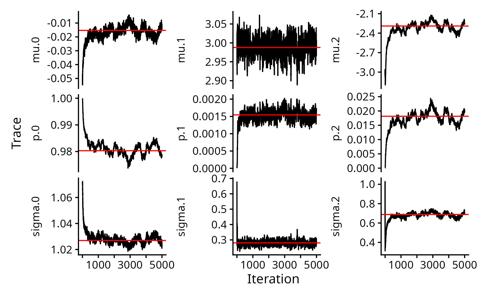
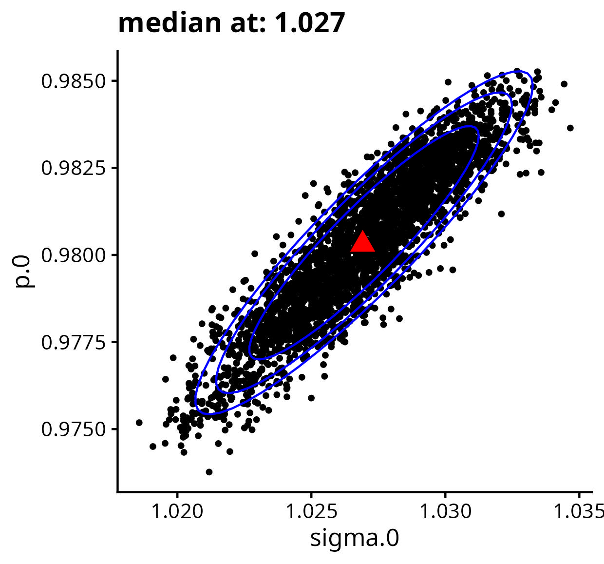
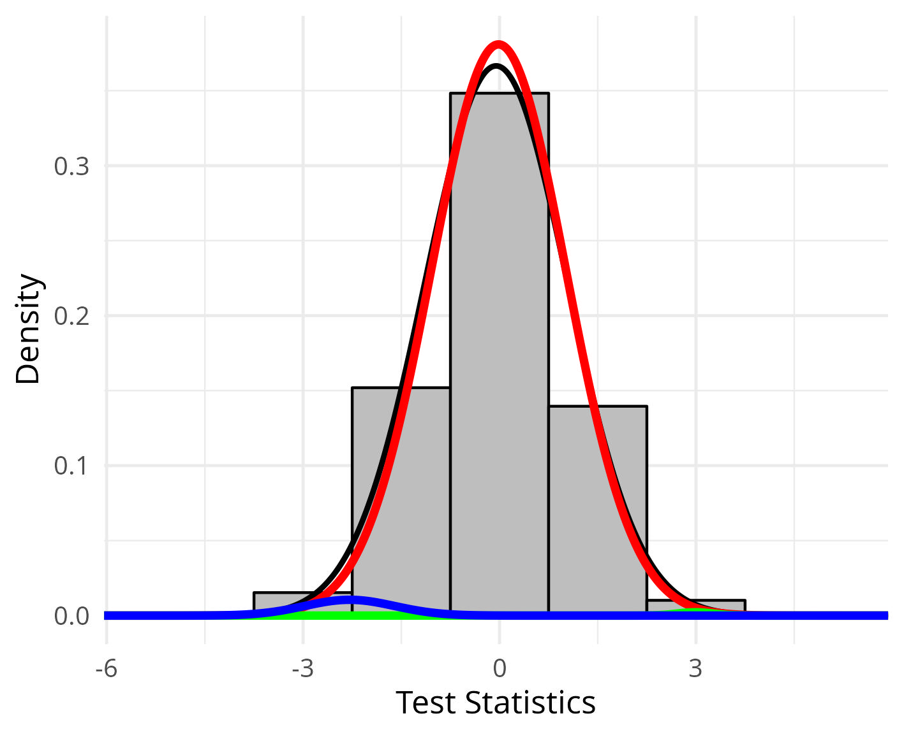
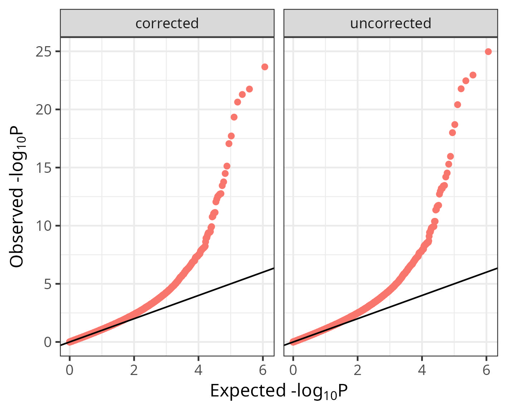

# Interpreting BACON plots

There are four plot types output from the bias- and inflation- adjustment analysis step to assess the performance of the Gibbs Sampler algorithm including:

* **Traces**: traces-plots of all estimates (sigma, p, mu)
* **Posteriors**: scatter plot of the Gibbs Sampler posterior probabilities for inflation (sigma.0) and proportion of null features (p.0). Elliptical curves correspond to 75%, 90%, and 95% probability regions.
* **Fit**: fit of the three component mixture over-layed on a histogram of z-scores. The black curve shows the overall fit, red shows the fit of the null distribution, and the blue and green curves show the alternatives.
* **QQ**: qq plots before and after adjustment with BACON.

Below are examples of what these plots should look like when the Gibbs Sampler algorithm has performed well. Poor performance can be an indication that there is something problematic with the underlying data; perhaps there are extreme outliers that were not removed prior to analysis, or maybe there is a confounding factor that isn't properly accounted for in the EWAS model. If the plots look like those shown below, then the EWAS results are likely to be reliable. If the plots look different, then further investigation is needed to determine the cause of the poor performance.

### Traces Plot

The traces plot shows the evolution of each parameter over time during the Gibbs Sampler algorithm. The algorithm begins with the provided priors and iterates until it converges on a set of estimates for each parameter. If the initial prior for a parameter is not close to the final estimate, there will be a period of divergence before convergence occurs. This can be seen in the traces plot as a sharp change in the value of the parameter at the beginning of the algorithm and then a gradual approach towards the final estimate. If the initial prior is close to the final estimate, then the algorithm will converge quickly and the plot will appear like a 'hairy caterpillar' (not a smooth line).

In the above plot, you can see that the traces converged on their respective estimates after a period of divergence for all parameters except mu.1. The initial prior estimate for mu.1 was close to the final estimate (the range of estimates is relatively small), so the algorithm converged quickly and resulted in a 'hairy caterpillar' plot.

### Posteriors Plot

The posteriors plot is a scatterplot of the estimated posterior values of the parameters mu.0 and p.0. The distribution of posterior values should be normally distributed for each parameter, thus the scatterplot should appear like a dense cloud of points. A sparse cloud indicates the algorithm was not able to converge on an estimate quickly (if at all).

### Fit Plot

The fit plot shows the distribution of the z-scores for each observation in the dataset as a histogram. Overlayed is a black density line of the overall fit of the model estimated by the Gibb's Sampling algorithm based on three components: a null component (red density line) and two alternate components (blue and green density lines). In the case of an EWAS:

* **Null Component**: The background noise or null hypothesis that a CpG is not significantly associated with the phenotype.
* **Alternate Components**: The alternative hypotheses; the CpG is significantly associated with the phenotype in a negative or positive way.

If the estimated distribution (black line) is vastly different from the observed distribution, then the model may be mis-specified and/or the Gibb's Sampling algorithm did not converge on an estimate. If the estimated distribution is similar to the observed distribution, then the model is likely correctly specified.

### QQ Plots

QQ plots are a scatterplot of the observed p-values against the expected p-values under the null hypothesis. The diagonal line represents the perfect fit between the observed and expected values. In the case of an EWAS, the points should follow the diagonal line relatively closely, with a spike of points at the end of the plot which represent the significant associations. Deviation from the diagonal line prior to the spike (if there is one) indicates there is global bias and/or inflation of the observed data. After adjustment  with BACON ('corrected' panel), the points prior to the spike should follow the diagonal line more closely. If there is still evidence of global bias and/or inflation after adjustment, then the model may be mis-specified.

Often, the BACON adjustment does not drastically change the observed p-values compared with the unadjusted p-values and it can be difficult to assess visually whether the BACON adjustment 'worked'. The effect of the adjustment can more easily be discerned with a metric often referred to as the 'genomic inflation factor', or lambda (λ), which is a calculation of the deviation of the observed p-values from the expected p-values. A value of 1 indicates no inflation, while values greater than 1 indicate inflation and less than 1 indicate deflation. In general, the BACON adjustment should bring the λ closer to 1. The unadjusted λ ('lambda') and BACON-adjusted ('b-lambda') values can be found in the output results file ending in 'ewas_bacon_results'.
