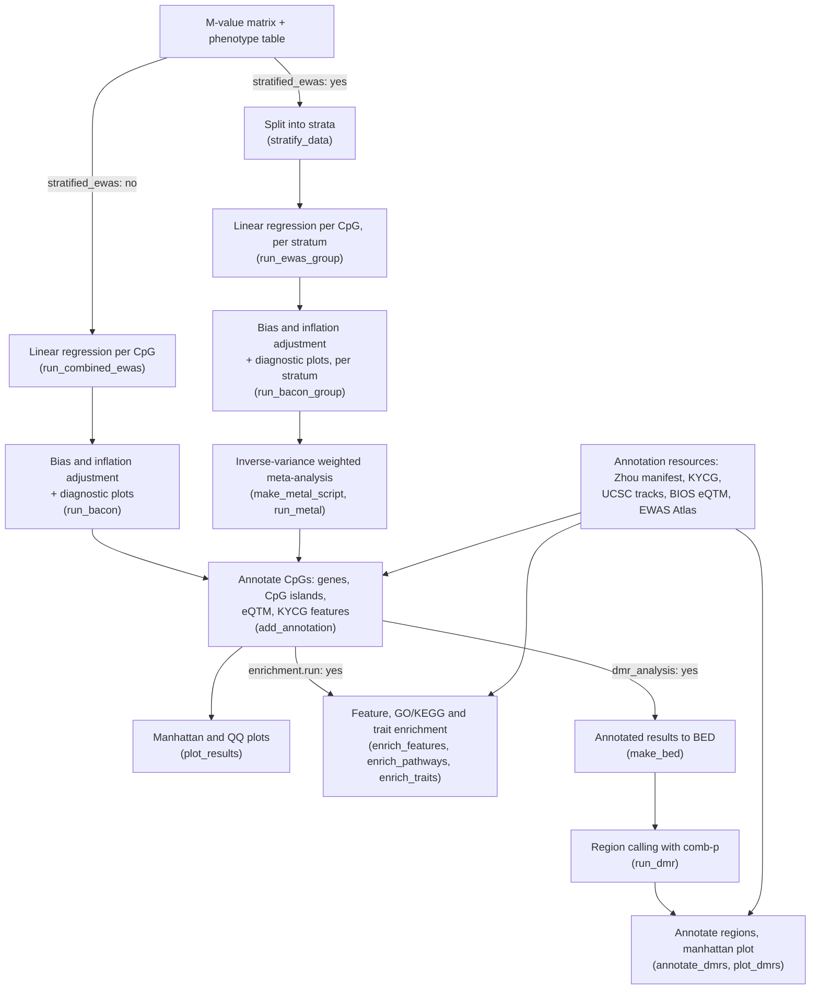
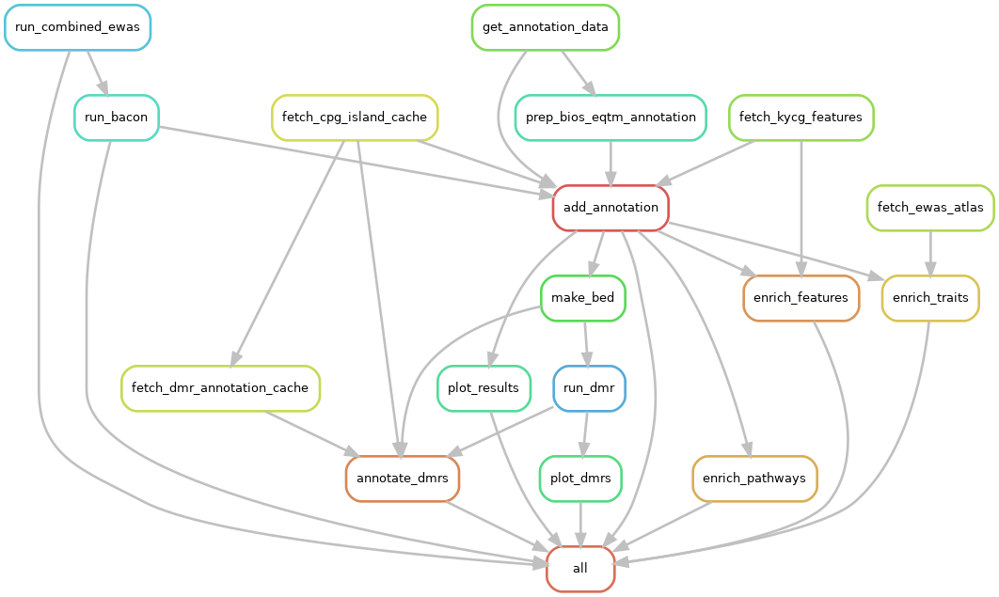
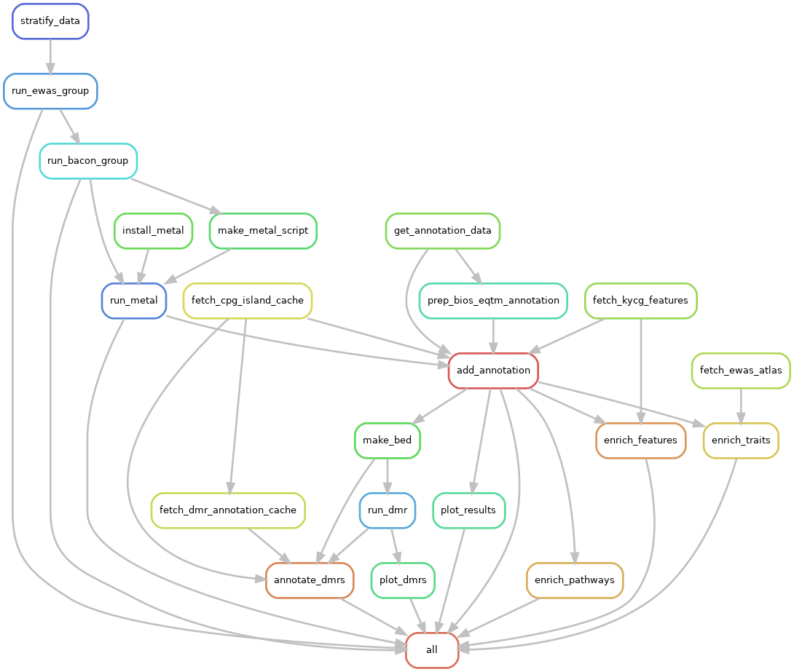

# Workflow overview

Optional stages are labelled in the config;
rule names are in parentheses.

The run command and configuration is recorded for each run that executes at least one job-- see [Run Provenance](outputs.md#run-provenance). Rule-level graphs of the complete workflow for both standard and stratified EWAS are shown below.

## Rule graphs

=== "Standard EWAS"

    

=== "Stratified EWAS"

    
